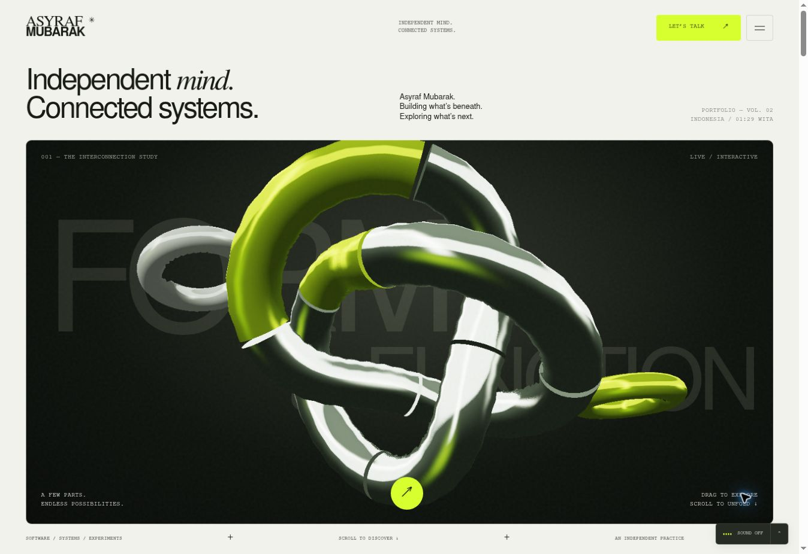

# Asyraf Mubarak — Independent mind. Connected systems.

A buildless portfolio using HTML, CSS, native JavaScript, WebGL, Canvas 2D, CSS perspective, Web Audio, and the Web Animations API. No runtime package or remote asset request is required.

This is the second composition: a full-scale interconnection sculpture, a serif/sans identity chapter, four viewport project stages, a personal spatial environment, and an inset closing stage. Lusion and Lando Norris are the primary visual studies. The [reference map](docs/rebuild/REFERENCE_STUDY.md) identifies specific scenes and timestamps from the owner's recordings.



## Run and verify

Serve `dist/` with any static HTTP server. For example, from the repository root:

```sh
python3 -m http.server 4173 --directory dist
node scripts/check.mjs
```

Node 20.11 or newer is required for checks. There is no build step. `.openai/hosting.json` retains the existing Site identity and points to `dist`. GitHub Actions runs the integrity and geometry checks.

## Fill the media, one canvas at a time

All 19 project, portrait, workspace, and closing media canvases are intentionally empty. No stock photograph, generated project poster, imitation screenshot, or reference-site media is included. The sculpture is procedural code, separate from the media slots.

Put your own files in `dist/assets/`. In `dist/content.js`, set a slot's `src`, `type`, and `alt`. `media` contains the four main project images; `mediaSlots` contains the secondary and personal areas.

```js
schoolai: {
  src: '/assets/schoolai.webm',
  type: 'video',
  alt: 'A walkthrough of the SchoolAI public platform',
  fit: 'contain' // optional: 'cover' (default) or 'contain'
}
```

For an extra slot, edit the corresponding entry after the default `mediaSlots` declaration:

```js
mediaSlots.portrait = {
  src: '/assets/portrait.png',
  type: 'image',
  alt: 'Portrait of Asyraf Mubarak',
  fit: 'contain',
  position: 'center bottom' // optional CSS object-position
};
```

Use a PNG/WebP with alpha for transparent cutouts. Leave `src: null` to preserve the empty area. Main project slots are shared between the project stage and its full-screen story. Each project has an independent `-detail` slot. Video is muted, inline, and paused offscreen or when motion is disabled. The 19 slot names are checked against the document.

## Sound

Sound starts only after an explicit play action. With `audioTrack = null`, the site plays an original generative ambient pad. To bundle a track, set:

```js
export const audioTrack = {
  src: '/assets/studio-track.mp3',
  title: 'Your track title'
};
```

The sound settings also accept a local audio file. The file stays in the visitor's browser and is never uploaded. The volume preference persists; sound does not autoplay on a new visit. Reset returns to the bundled/generative sound.

## Navigation and motion

- Native scrolling expands the opening stage and unfolds the sculpture. Desktop scroll moves through four project stages; narrow screens use a vertical sequence.
- Drag the sculpture or use arrow keys. Space toggles separation; Home resets its orientation and assembly. Touch scrolling is kept native.
- The project index selects a stage. Project stories use `#project/<key>` routes, native dialogs, browser Back, Escape, focus restoration, and coordinated strip transitions.
- The workspace contains four perspective media planes. Drag/use arrow keys to orbit; Home resets it. The three notes describe the real Arch/Openbox setup.
- The footer's motion control and `prefers-reduced-motion` provide a linear experience. Audio and media are independently controlled.

## Rendering and verification

WebGL uses per-fragment procedural studio reflections. The fallback uses the same mesh members, indexed vertex transforms, a depth buffer, and smooth normal shading. Fallback frame rate and pixel count are deliberately bounded. Both stop when offscreen, hidden, or covered by a dialog.

See [VERIFICATION.md](VERIFICATION.md) for actual browser coverage and remaining GPU verification. No award equivalence, benchmark score, or physical-device certification is claimed.

## Content and fonts

Project facts come from the owner's SchoolAI, GlassPos, meawpos-api, miawpos-ui, and dotfiles repositories. MiawPOS remains described as in development with a documented narrow working chain. Public contact: `asyrafwebsite@gmail.com`.

Bundled Nimbus Sans, Nimbus Roman, and Nimbus Mono PS are from URW Base 35. See [THIRD_PARTY_FONTS.txt](THIRD_PARTY_FONTS.txt).
