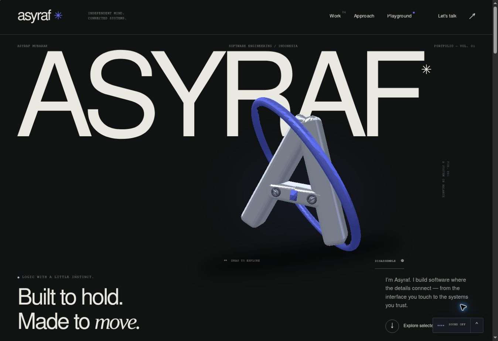

# AsyrafCloud | Open Systems Studio

**Systems in Motion** — a personal portfolio for Asyraf Mubarak. A mechanical identity, an editorial project index, and an explorable Arch Linux workspace tell one connected story.

## Run

No package manager or build step is required. Serve `dist/` from any static web server:

```sh
python3 -m http.server 8080 --directory dist
```

Open `http://localhost:8080`. Use an HTTP server rather than opening `index.html` directly, because the interactive enhancement uses JavaScript modules.

## Structure

- `dist/index.html`: semantic content and accessible static baseline.
- `dist/style.css`: responsive editorial composition and interaction states.
- `dist/assets/`: locally bundled fonts and original vector artwork. Project media is intentionally left for the owner to fill.
- `dist/webgl.js`: original geometry, GPU lighting, and a depth-buffered software 3D fallback.
- `dist/scene.js`: scene lifecycle, orbit controls, disassembly, and workspace inspection.
- `dist/app.js`: routes, WAAPI transitions, galleries, motion preferences, and progressive enhancement.
- `dist/audio.js`: optional generative ambient sound and local-track controls.
- `dist/content.js`: project text, image/video slots, and an optional soundtrack.
- `DESIGN_REFERENCES.md`: the reference and adaptation for each section, style, and interaction.
- `.openai/hosting.json`: deployment configuration for the corresponding Site.

The experience is designed to work without third-party CDN requests. WebGL and motion progressively enhance the readable HTML.

## Content sources

Project descriptions and engineering approach are based on the public READMEs in [Asyraf2003/Asyraf2003](https://github.com/Asyraf2003/Asyraf2003), [schoolai](https://github.com/Asyraf2003/schoolai), [GlassPos](https://github.com/Asyraf2003/GlassPos), [meawpos-api](https://github.com/Asyraf2003/meawpos-api), [miawpos-ui](https://github.com/Asyraf2003/miawpos-ui), and [dotfiles](https://github.com/Asyraf2003/dotfiles).

All project-media areas are intentional styled slots, per the owner's direction. MiawPOS is presented as in development. The fourth project is this portfolio.

Nimbus Sans and Nimbus Mono PS are from URW Base35; their license and font exception are included in `THIRD_PARTY_FONTS.txt`.

## Delivery sequence

1. Editorial foundation and verified project stories.
2. Native WebGL monogram and explorable workspace.
3. WAAPI interactions, project case studies, accessibility, and browser verification.

The visual target is the craft of leading award-winning experiences. No award, certification, or measured performance claim is made by this repository.

## Fill the media areas

Put the desired files in `dist/assets/` and set one `src` at a time in `dist/content.js`:

```js
schoolai: {src:'/assets/schoolai.webm',type:'video',alt:'SchoolAI walkthrough'}
```

Use `type: 'image'` for images. Leave `src: null` to keep a designed placeholder. For a fixed soundtrack, set `audioTrack` to `{src:'/assets/studio.mp3',title:'Studio mix'}`. Visitors can also choose a local audio file in the radio controls; it is played in their own browser.

## Review

The primary design benchmarks are **Lusion.co** and **Lando Norris**. The footer's **Design Notes** opens the area-by-area map. Detailed primary sources and interpretation limits are in `DESIGN_REFERENCES.md`.

Run static checks with `node scripts/check.mjs`. Browser verification and its actual limits are recorded in `VERIFICATION.md`. No external JavaScript, animation library, CDN font, or generated image is needed.

## Preview


